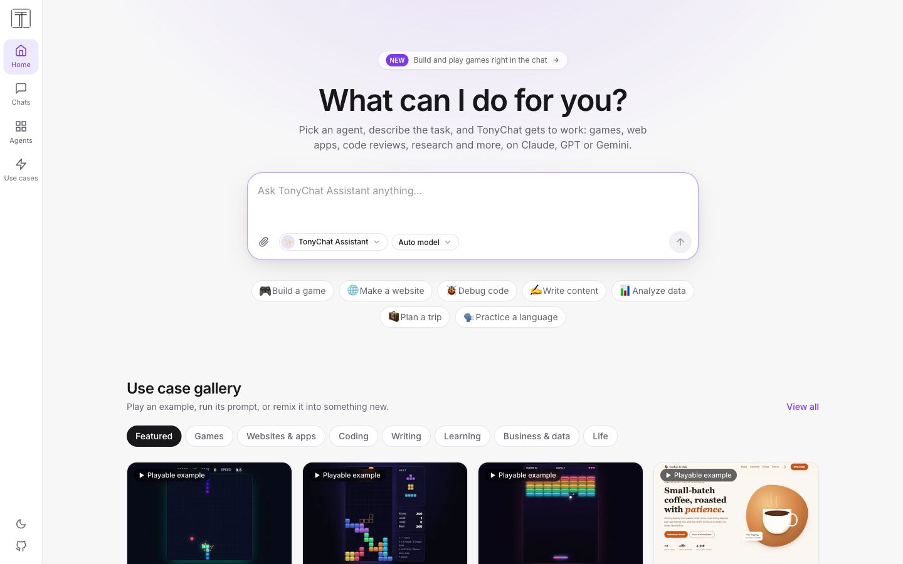
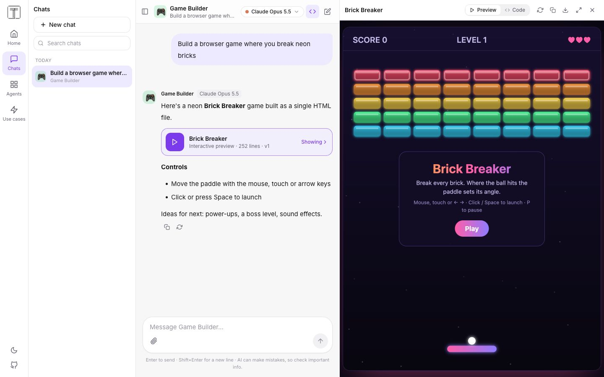
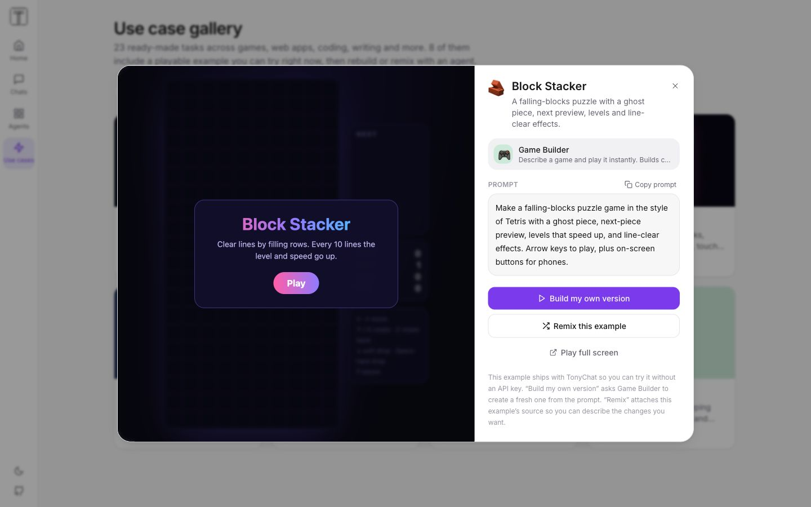
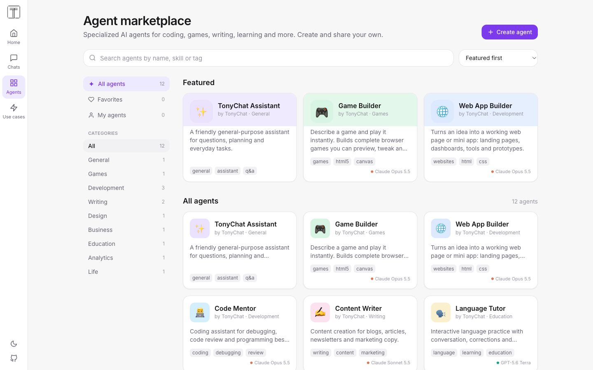

# [Tonychat](https://tony-chat-nine.vercel.app/)

**TonyChat is a open-source multifunctional Agent, which you can use for your personal and business purpose safely. It supports customized Agent deploy, easy fine tuning your models, safety and privacy. The platform is designed to make it easy for anyone to find, share, and use prompts to develop AI applications.**

## Features



- **Prompt-first home.** Describe a task, pick an agent and a model, and go. Quick actions set up common jobs in one click.
- **Agent marketplace.** 12 built-in agents with tuned instructions and a recommended model. Create your own, customize a copy, favorite, and share an agent with a link.
- **Live artifacts.** When an agent writes a complete HTML page, game or SVG, it streams into a side panel and then runs in a sandboxed preview, with Code view, versions, reload, download and full-width mode.
- **Game and web app building.** The Game Builder and Web App Builder agents produce single-file games and sites you can play or use right away.
- **Use case gallery.** 23 ready-made tasks. 8 ship with playable examples (6 games, 2 web apps) that work without an API key and can be rebuilt or remixed by an agent.
- **Free models.** Use TonyChat without paying: Google Gemini's free tier, about 20 free OpenRouter models, Groq, Mistral's free plan, Zhipu GLM-4.7-Flash, SiliconFlow's free Qwen and GLM models, or local models through Ollama.
- **Bring your own key.** Visitors paste their own (free) key in Settings; it is checked with a free read-only call, kept in their browser, and only forwarded with their own requests.
- **Multi-model.** Claude, GPT, Gemini and the providers above with streaming replies, per-chat model choice, collapsible reasoning for thinking models, and automatic mapping of retired model ids.
- **Chats and files.** Multiple conversations with search, rename and delete; text-file attachments such as code, CSV and Markdown; Markdown rendering with syntax highlighting.
- **Light and dark themes, phone-friendly layout.** Everything is stored in the browser, so no database is required.

| Live game preview in chat | Playable use case examples |
| --- | --- |
|  |  |



## Highlights

- Next.js (App Router) + TypeScript + Tailwind CSS, with a small semantic design-token system for light and dark themes
- Streaming chat API for Anthropic, OpenAI and Google, with legacy routes and model-id migration
- Sandboxed artifact previews (`sandbox="allow-scripts"` without same-origin access)
- Retrieval-Augmented Generation (RAG) microservice (FastAPI + LangChain), optional

## Quick start (local)

Prerequisites

- Node.js (v18+ recommended)
- Python 3.10+ for the RAG microservice (optional)
- pip for Python packages

1) Install frontend dependencies

```bash
npm install
```

2) Create environment variables

Create a `.env.local` in the project root. Example variables used by this project include:

```env
# Free options (any one is enough; visitors can also add their own keys in Settings)
GOOGLE_GEMINI_API_KEY=your-google-ai-studio-key
OPENROUTER_API_KEY=sk-or-...
GROQ_API_KEY=gsk_...

# Paid options
ANTHROPIC_API_KEY=sk-ant-...
OPENAI_API_KEY=sk-...

# Optional RAG microservice
NEXT_PUBLIC_BACKEND_URL=http://localhost:8001
```

Note: the project declares many environment variables in `config/server.ts`; only set the keys you need for your chosen providers. Supabase is no longer required: chat history, custom agents and favorites are stored in the browser.

## Supported models

The catalog lives in `lib/modelConfig.ts` and the provider list in `lib/providers.ts` (reviewed 2026-10-23). Free model lists change often, so OpenRouter, Groq, Mistral and Ollama models are also discovered at runtime.

| Provider | What's free | Default model | Key |
| --- | --- | --- | --- |
| Google Gemini | Free tier: Gemini 3.8 Flash, 3.5 / 3.1 Flash-Lite (Pro and Argon need billing) | Gemini 3.8 Flash | [AI Studio](https://aistudio.google.com/apikey) |
| OpenRouter | About 20 `:free` models, 50 requests/day (1,000 after a one-time $10 top-up) | Free router (auto) | [openrouter.ai](https://openrouter.ai/settings/keys) |
| Groq | Free tier, about 30 requests/min and 1,000/day | GPT-OSS 120B | [console.groq.com](https://console.groq.com/keys) |
| Mistral | Free Experiment plan (prompts may be used for training) | Mistral Small | [console.mistral.ai](https://console.mistral.ai/api-keys) |
| Zhipu GLM | GLM-4.7-Flash and GLM-4-Flash, one request at a time | GLM-4.7-Flash | [bigmodel.cn](https://bigmodel.cn) |
| SiliconFlow | Small models such as Qwen3-8B and GLM-4-9B after identity verification | Qwen3 8B | [siliconflow.cn](https://cloud.siliconflow.cn) |
| Ollama | Local models on your own machine (self-hosted only) | First installed model | `OLLAMA_BASE_URL` |
| Anthropic | Paid | Claude Opus 5.5 | [platform.claude.com](https://platform.claude.com/) |
| OpenAI | Paid | GPT-5.6 Terra | [platform.openai.com](https://platform.openai.com/api-keys) |

**Keys from the server vs. visitor keys.** Keys in the server environment pay for every visitor, so requests on them are limited to catalog models, OpenRouter `:free` models and models the provider lists for that key. A visitor's own key (Settings) can use any model of that provider and is never stored on the server.

**Legacy model ids.** Agents, browsers and API clients that still send retired ids (for example `gpt-4`, `claude-3-sonnet-20240229` or `gemini-1.5-pro`) keep working. `resolveModel()` maps them to the closest current model, and the response carries `X-Model` and `X-Model-Migrated-From` headers. Add explicit mappings to `LEGACY_MODEL_ALIASES` when a provider retires a model.

**Chat API.** `POST /api/chat` with `{ model, systemPrompt, messages: [{ role, content }] }` streams plain text. The old `POST /api/chat/{openai|claude|cluade|gemini|google}` routes with `{ message, model }` still return a JSON string. `GET /api/models` reports which providers the server has configured plus runtime-discovered models; `POST /api/models` verifies a visitor's key. Visitors' keys travel in the `X-Provider-Key` header (and `X-Provider-Region` for Zhipu and SiliconFlow).

3) Start the Next.js dev server

```bash
npm run dev
# open http://localhost:3000
```

4) (Optional) Start the RAG microservice

The repo includes a Python RAG microservice at `backend/rag_service.py`. It loads content from `docs/tech` and exposes a `/rag/query` endpoint used by the frontend.

```bash
# create a venv (recommended)
python -m venv .venv
source .venv/bin/activate
pip install -r requirements.txt  # or: pip install fastapi uvicorn langchain openai faiss-cpu
uvicorn backend.rag_service:app --reload --port 8001
```

The frontend expects the RAG endpoint at `NEXT_PUBLIC_BACKEND_URL` (default `http://localhost:8001`).

## Project structure (high level)

- `app/` — Next.js frontend (App Router) and API routes. Key folders:
  - `app/page.tsx` — home: prompt composer, quick actions, use case gallery, featured agents
  - `app/chat/` — conversations, streaming chat and the artifact preview panel
  - `app/store/` — agent marketplace; `app/usecases/` — use case gallery
  - `app/components/` — shell (navigation, theme), chat, agents, use cases and UI primitives
  - `app/api/chat/` — unified streaming chat endpoint, legacy per-provider routes, repo chat
- `backend/` — RAG microservice (FastAPI) and tests
- `lib/` — model catalog (`modelConfig.ts`), agents (`agents.ts`), use cases (`usecases.ts`), browser storage for agents and chats (`agentStore.ts`), artifact parsing (`artifacts.ts`), server-only provider adapters (`lib/server/`)
- `public/examples/` — the playable example games and sites used by the gallery, plus their cover images
- `config/` — server config and environment declarations

## Environment variables used by the app

Key environment variables referenced in the codebase include (not exhaustive):

- `ANTHROPIC_API_KEY` — Anthropic API key
- `OPENAI_API_KEY` — OpenAI API key
- `GOOGLE_GEMINI_API_KEY` (or legacy `GEMINI_API_KEY`) — Google Gemini API key
- `OPENROUTER_API_KEY`, `GROQ_API_KEY`, `MISTRAL_API_KEY`, `ZHIPU_API_KEY`, `SILICONFLOW_API_KEY` — free and free-tier providers
- `OLLAMA_BASE_URL` — local Ollama server for self-hosted setups
- `*_BASE_URL` (for example `ANTHROPIC_BASE_URL`, `GROQ_BASE_URL`, `ZHIPU_BASE_URL`) — optional proxy, gateway or international endpoints
- `AZURE_OPENAI_API_KEY` — Azure OpenAI key
- `NEXT_PUBLIC_AZURE_OPENAI_ENDPOINT` — Azure OpenAI endpoint
- `NEXT_PUBLIC_BACKEND_URL` — URL of the RAG or backend API

See `config/server.ts` for the full list of declared environment variables and where they map into server config.

## Scripts

From `package.json`:

- `npm run dev` — run Next.js in development mode
- `npm run build` — build for production
- `npm run start` — start the production server
- `npm run lint` — run ESLint

## RAG & knowledge base

- Knowledge docs live under `docs/tech`. Edit or add files there to expand your domain knowledge.
- The RAG microservice in `backend/rag_service.py` loads `docs/tech` (or other configured sources) and exposes endpoints the frontend can call.
- There are test helpers in `backend/test_rag_api.py` and `backend/test_rag_curl.sh` to exercise the RAG endpoints.

## Deploying

- Vercel is a great option for deploying the Next.js frontend. Configure environment variables in your Vercel project settings.
- If you deploy the RAG service, host it separately (e.g., a VM, Docker container, or serverless function) and point `NEXT_PUBLIC_BACKEND_URL` at it.

## Contributing

Contributions are welcome. A few suggestions:

- Open an issue to discuss new features or bugs.
